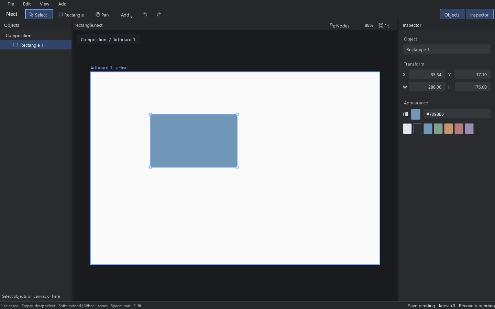

# Nect desktop workspace

This is the first redesigned desktop vertical, built from `52365d3653bda02d3bf238a606d80f7a398ff923` on the isolated `codex/desktop-workspace-20261016` branch. The existing Nect and Nect-SVG implementations supply behavior and requirements; Nect-Cloud is outside this change.

## Design contract

The screen's job is to create and revise one editable artwork. Primary path: blank document → Rectangle tool → canvas drag → Objects selection → move → numeric size/fill → Undo/Redo → save native → reopen and edit.

Use the standard Windows titlebar. Menu 24 DIP, command/header 32, status 22. Objects starts at 208, Inspector at 280, with a resizable canvas between them. Inspector order is name, Transform (X/Y and W/H in two columns), Appearance. Nodes is explicitly opened below the canvas and closed initially. No timeline, empty node placeholder, free docking, or separate graph state.

The parent UI brief uses Blender's restrained headers, aligned numeric columns and wide workspace, and Resolve's stable panel locations. It specifies 4/8/12/16 spacing, 28 DIP controls, 13 DIP Windows UI type, 12 DIP secondary text, thin boundaries and one blue selection/focus accent. Widgets use a shared palette/style, vector stroke icons and consistent focus. Artwork color remains independent of UI accent. Qt owns DPI scaling.

Below 1200 logical pixels Objects collapses. Below 800, opening either sidebar closes the other and Inspector starts at 240 DIP; wider windows retain 280 DIP. Numeric fields keep two columns, 28 DIP height and 13 DIP type. Secondary command buttons recede; the Add menu keeps the same action available. The Inspector scrolls vertically. Font size stays fixed.

Canvas interaction hints live in the fixed 22 DIP status bar, outside the artwork. Long hints elide with the full text available as a tooltip. The header owns the zoom readout. Fit follows the actual viewport when Nodes opens/closes or a panel changes size; manual zoom/pan keeps its mapping until Fit is explicitly requested again. These are presentation states only, with no History or save-format changes. Legacy Canvas presentation defaults remain unchanged.

## Data flow

`Document → pure core evaluation → Canvas projection / NodeView projection`

`Canvas / Inspector → existing typed Commands → one Host::session → existing History and protection / native save`

- `Workspace` owns the desktop Host and selection/panel/input state. It does not own a second artwork model.
- `Canvas` retains existing hit testing, movement, gesture ownership, projection and QPainter rendering. The new shell adds only viewport coordinate access and optional presentation colors; legacy defaults remain unchanged.
- Rectangle creation previews `CreatePrimitive` through `Session::begin/update/commit_gesture`. Cancel restores authored state. A committed drag is one History entry.
- Numeric/color/name drafts record object, Session identity and revision. Stale or invalid edits refuse; driven numeric sources are read-only. Escape restores the displayed committed value.
- `NodeView` derives the real retained source, Point Edit, transform, processing stack and output from the selected object. Clicking a node focuses the corresponding Inspector area. Topology is read-only in this vertical; it has no independent graph evaluator, History or save format.
- `Host` retains native conflict detection, QSaveFile replacement, recovery and asset behavior. Studio has its own recovery directory and does not read or modify legacy global QSettings.

Qt 6.5.3 Core/Gui/Widgets/Network/Test are installed on this host; Quick/QML is absent. The first shell therefore uses Widgets with deliberate layout/style and QPainter. This is a runnable native application, with no web engine or new dependency installation.

## Compatibility and migration scope

The existing native `nect-native 0.87` codec and authored data model are unchanged. Studio opens documents through the production `Host::open` and saves through `Host::save`. Unsupported input is rejected by the codec rather than partially imported. The previous Nect executable and all sources remain available.

This vertical exposes rectangle creation, object/hierarchy selection, existing direct movement and keyboard nudge, literal translation/rectangle size, solid Fill editing, Undo/Redo, save/open and a derived pipeline. Other native objects can be projected/preserved by the existing Canvas/codec, but advanced editing controls (text, images, gradients, masks, expressions, Group tools, libraries, arbitrary operators, API UX) have not been migrated into the new shell. Read-only driven values preserve their sources. A missing solid Fill or unsupported dimension is explicit in the Inspector.

Nect-SVG graph JSON (schema 1–10) is a different contract. Studio does not claim direct compatibility or silently flatten it. Graph wiring/free node layout/Boolean/Remap and JS-specific semantics remain future migration work. Originals must be kept. The pipeline projection is the first common-document surface, not a completed general graph editor.

## Build and run

```powershell
./scripts/build-studio.ps1
./build-studio/Release/nect_studio.exe --recovery-dir ./build-studio/interactive-recovery
```

The build script uses the installed Qt/Boost paths by default (both overridable), an independent build directory, the existing `Local\NectBuild` zero-timeout mutex, and serial `/m:2 /nodeReuse:false` Windows builds. It deploys Qt locally, without changing OS settings or installing dependencies.

```powershell
$env:QT_QPA_PLATFORM='offscreen'
./build-studio/Release/studio_workflow_tests.exe ./build-studio/evidence
```

`--capture path.png` on the application renders its actual Qt widget tree and exits. This is a source-rendered image, not a native desktop screenshot or evidence of physical pointer/IME/DPI behavior. Physical screenshot capture is independently blocked on this host by MXC initialization `HRESULT 0x80070003`. Do not retry that path without new host evidence.

For offscreen rendering on Windows set `QT_QPA_FONTDIR` to the existing Windows Fonts directory. The workflow test does this in its own process; fonts are neither copied nor distributed. Use `QT_SCALE_FACTOR` per capture process rather than changing OS display settings. `--select-first` selects an object opened with `--open` for inspection. Capture sidecars record actual logical/pixel sizes and device-pixel ratio.

## First verified result

The Windows Release build and 23-check workflow pass. See [verification](desktop-workspace/verification.md) for hashes and evidence boundaries. These are the actual Qt widget renders:

| Requested surface | Logical client | Render |
| --- | --- | --- |
| 1440×900 at 100% | 1440×900 | [Image](desktop-workspace/1440x900-100.png) |
| 1024×900 at 100% | 1024×900 | [Image](desktop-workspace/1024x900-100.png) |
| 1440×900 at 150% | 960×600 | [Image](desktop-workspace/1440x900-150.png) |
| 1024×900 at 150% | 683×600; Qt rounds output width to 1025 | [Image](desktop-workspace/1024x900-150.png) |

[Blank](desktop-workspace/blank.png) · [Selected object pipeline](desktop-workspace/pipeline.png)


